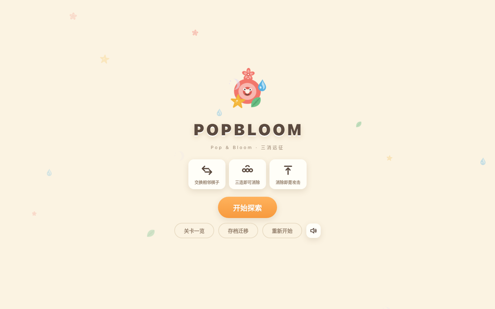
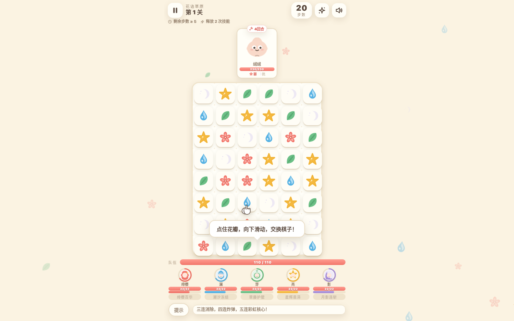
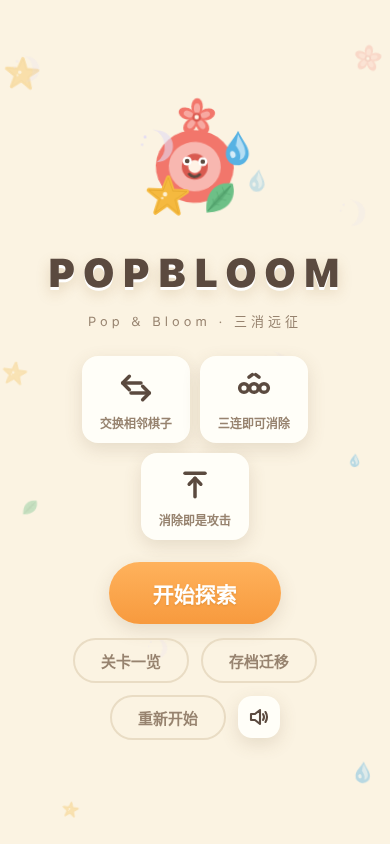
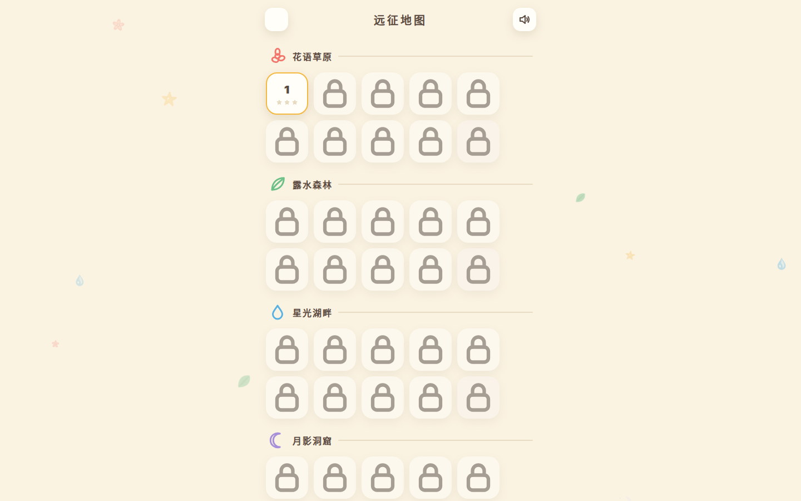

<div align="center">
<h1>
  🌸 POPBLOOM
</h1>

<p><strong>三消远征 · Match. Battle. Bloom.</strong></p>

<p>穿越六片奇幻花海，集结五位英雄，<br>
用策略与元素之力，开启 60 关的远征之旅。</p>

</div>
<br/>


[🎮 开始游戏](https://play.gemmae.dev/)（Cloudflare Pages，构建产物）
[🎈 备用地址](https://game1-4cf.pages.dev/)
[📖 玩法介绍](#-核心玩法)　
[⚙️ 技术架构](#-技术栈)


<br/>


</div>

---
## ✨ 游戏简介

POPBLOOM 是一款融合三消玩法与 RPG 战斗机制的网页游戏。

在这里，棋盘不只是消除空间，更是英雄们的战场。
玩家通过交换相邻棋子触发消除，将元素能量转化为攻击，
搭配英雄技能、特殊棋子与战斗祝福，
在有限步数内击败不断来袭的怪物。

<div align="center">

| 🌷 冒险章节 | ⚔️ 英雄角色 | 🏆 精彩关卡 | 💎 祝福效果 |
|:---:|:---:|:---:|:---:|
| **6** | **5** | **60** | **20** |
| 奇幻花海 | 专属技能 | 策略挑战 | 成长组合 |

</div>

---

## 🎮 核心玩法

### 01 · Match & Attack
**三消即战斗**

交换相邻棋子，连接三个及以上相同元素，
将消除能量转化为攻击，击中怪物弱点可造成更高伤害。

### 02 · Element Strategy
**五色元素**

🔥 炎 · 💧 潮 · 🍃 风 · ⭐ 光 · 🌙 月

观察敌人的弱点与抗性，选择合适的元素，
让每一次消除都发挥最大价值。

### 03 · 五位英雄，各有绝活

全队共享 110 点生命值，由五位英雄平分，每人拥有 22 点生命值。消除对应颜色的棋子可以为英雄积累能量，能量充满后即可释放专属技能。

英雄生命值降至 0 时会陷入晕厥，暂时无法释放技能，但可以通过治疗恢复生命，重新加入战斗。

| 英雄 | 称号 | 专属技能 | 技能效果 |
|:---:|:---|:---|:---|
| 🌸 绯樱 | 花剑士 | 绯樱百华 | 对当前血量最高的敌人造成 7 倍攻击伤害 |
| 💧 澜 | 潮汐法师 | 潮汐冻结 | 全体敌人延后 2 回合，各受到 2 倍攻击伤害 |
| 🍃 芽 | 翠藤守卫 | 翠藤护壁 | 获得 40 点护盾，抵挡怪物伤害 |
| ⭐ 亮 | 星辉牧师 | 星辉恩泽 | 立即恢复全队 45 点生命 |
| 🌙 影 | 月影游侠 | 月影连斩 | 对所有敌人各造成 2.5 倍攻击伤害 |

战斗开始前，系统会弹出「远征队伍」面板，集中展示五位英雄及其技能信息；战斗过程中，点击英雄头像即可随时查看角色详情。



### 04 · Roguelike Blessings
**祝福叠加，打造专属流派**

每场胜利后从三种祝福中选择其一，
通过伤害强化、生命恢复、能量增益等效果，
不断调整自己的远征策略。

### 05 · Special Combos
**特殊棋子，创造连锁爆发**

炸弹、彩虹核心、十字雷自由组合，
触发大范围消除与连锁爆炸，扭转战局。

| 特殊棋子组合 | 组合效果 |
|:---|:---|
| 🌈 彩虹核心 + 彩虹核心 | 清除全场 42 格 |
| 🌈 彩虹核心 + 炸弹 | 指定颜色的每颗棋子各触发一次 3×3 爆炸 |
| 🌈 彩虹核心 + 十字雷 | 指定颜色的每颗棋子各清除一行一列 |
| 💣 炸弹 + 炸弹 | 在落点触发 5×5 超级爆炸 |
| 💣 炸弹 + 十字雷 | 清除整行、整列，并在双落点触发 3×3 爆炸 |
| ⚡ 十字雷 + 十字雷 | 在两个落点分别清除整行与整列 |

建议合理保留并交换特殊棋子，是突破高难度关卡、实现大范围消除的重要策略。


### 06 · Element Sealing

**封印元素：在限制中寻找突破口**

从第 17 关开始，部分棋子颜色会受到封印效果影响。

被封印颜色的棋子仍然可以正常消除，但不会造成伤害，也无法为对应英雄积累能量；与此同时，消除仍然会消耗步数，怪物也会照常行动。

随着关卡推进，被封印的颜色可能逐渐增多，玩家需要更加谨慎地规划消除顺序，充分利用剩余元素与英雄技能寻找突破机会。


### 07 · Smart Guidance

**从新手引导到策略提示，让每一步都有方向**

- **实时操作提示：** 点击「提示」按钮，棋盘会高亮推荐操作，优先展示特殊棋子组合与高分消除机会。
- **分步新手引导：** 第 1 关通过气泡提示引导玩家完成棋子交换、连续消除与英雄技能释放，帮助玩家快速理解核心规则。
- **特殊机制教学：** 彩虹核心首次出现时自动弹出玩法说明，降低特殊棋子的理解成本。
- **动态战斗提醒：** 底部提示卡根据当前战斗状态实时变化，在怪物即将攻击、英雄技能准备就绪等关键时刻提供视觉提醒。


### 08 · Save & Migration

**存档跟随设备走，冒险进度随时延续**

游戏支持自动保存机制，重新打开游戏时会自动恢复上一次的游戏进度。除非玩家主动选择「重新开始」，否则原有进度不会因普通退出而被重置。

同时，游戏提供跨设备存档迁移功能：

1. 在原设备标题屏中选择「存档迁移」。
2. 导出以 `BT1.` 开头的存档码。
3. 在新设备打开游戏，将存档码粘贴并导入。
4. 即可恢复原有游戏进度，继续此前的远征。

无需重新闯关，让每一次冒险都能顺利延续。


### 09 · Mobile Experience

**为不同屏幕尺寸优化的游戏体验**

游戏支持移动端触屏操作，玩家可以通过触摸与拖拽交换棋子，完成消除与战斗操作。

界面布局会根据设备屏幕尺寸自动调整，针对窄屏与矮屏设计了专门的压缩布局，使棋盘、操作按钮与战斗信息在不同尺寸的设备上保持良好的可用性。

<div align="center">



*移动端标题界面展示*

</div>


---

## 🌿 冒险世界

| 章节 | 关卡 | BOSS |
|:---|:---:|:---|
| 🌸 花语草原 | 01–10 | 花王·绒球 |
| 💧 露水森林 | 11–20 | 蘑菇长老 |
| ✨ 星光湖畔 | 21–30 | 深湖泡影 |
| 🌙 月影洞窟 | 31–40 | 洞窟石像 |
| 🍃 风暴崖顶 | 41–50 | 云端之王 |
| 🌺 终焉花园 | 51–60 | 终焉荆棘王 |
每 5 关的最后一波会出现超级 BOSS（精英怪，金边、大体型、带重击）
---



## 📱 游戏特色

- **策略战斗：** 元素克制、怪物主动攻击与有限步数相结合。
- **英雄养成：** 五位英雄拥有独立技能与能量机制。
- **动态成长：** 20 种祝福持续叠加，形成不同战斗流派。
- **关卡挑战：** 60 个关卡、六大章节与特色 BOSS。
- **沉浸体验：** 原生 SVG 绘制角色与图标，WebAudio 合成背景音乐和音效。
- **跨设备存档：** 支持进度自动保存与存档码迁移。
- **移动端适配：** 支持触屏操作与不同尺寸屏幕。

---

## 🛠️ 技术栈

| 技术 | 应用 |
|:---|:---|
| JavaScript | 游戏核心逻辑与交互 |
| Vite 7 | 项目构建与开发服务器 |
| CSS | 游戏界面与动画 |
| SVG | 游戏角色及图标绘制 |
| Web Audio API | 背景音乐与游戏音效 |
| Cloudflare Pages | 在线部署 |

---


## 🚀 本地运行

安装依赖后，即可启动开发服务器或构建项目。

```bash
# 安装依赖
npm install

# 启动开发服务器
npx vite

# 构建生产版本
npm run build

# 本地预览构建产物
npm run preview
```

> 注意：项目的 `package.json` 中没有配置 `dev` 脚本，因此开发服务器直接使用 `npx vite` 启动。

### 构建产物

执行 `npm run build` 后，生成的生产文件位于 `dist/` 目录：

```text
dist/
├── index.html
├── index_test.html
└── assets/
    ├── main-*.js
    └── style-*.css
```

其中，`index.html` 为游戏正式入口，`index_test.html` 为独立测试页面，使用隔离存储，不会读写真实游戏存档。

---

<div align="center">

```


## 🌐 部署

### Cloudflare Pages（推荐）

项目已连接 GitHub，向 `main` 分支推送代码后即可自动触发构建和部署。

| 配置项 | 内容 |
|:---|:---|
| 构建命令 | `npm run build` |
| 输出目录 | `dist` |
| 主访问地址 | https://play.gemmae.dev/ |
| 备用地址 | https://game1-4cf.pages.dev/ |

### GitHub Pages

项目也支持通过 GitHub Pages 访问：

https://keavy-561.github.io/game1/

该地址提供的是 `main` 分支根目录下的源码版本，而不是 Cloudflare Pages 构建后的生产产物。项目入口脚本已适配相对路径，可直接运行。

**推荐优先使用 Cloudflare Pages 版本**，以获得基于构建产物的线上游戏体验。
```


## 📁 目录结构

```text
game1/
├── index.html
├── index_test.html
├── build-single.html
├── style.css
├── js/
│   ├── main.js       # 游戏启动入口
│   ├── data.js       # 配置、英雄、怪物、祝福、关卡与存档
│   ├── board.js      # 棋盘匹配、特殊棋子、组合与提示
│   ├── battle.js     # 战斗回合、伤害、技能与怪物行动
│   ├── ui.js         # 界面渲染、动画与新手引导
│   ├── svg.js        # 角色及图标 SVG
│   ├── audio.js      # WebAudio 背景音乐与音效
│   └── util.js       # 随机数、存储与工具函数
├── docs/             # README 配图及游戏截图
└── 工作进度.md       # 项目开发过程记录
```


## 玩法小贴士

1. 先看怪物弱点色：消弱点色伤害 ×1.6，是前期最稳的输出。
2. 四连别急着消：炸弹留到怪物扎堆时再引爆，3×3 的收益远高于一次三连。
3. 彩虹核心别乱点：场上某种颜色特别多时再用，一次清十几颗。
4. 技能别攒着：怪物优先打能量最高的英雄，满了就放，放完再攒。
5. 祝福优先拿通用增伤与步数，单色祝福看你最顺手消哪种颜色。
