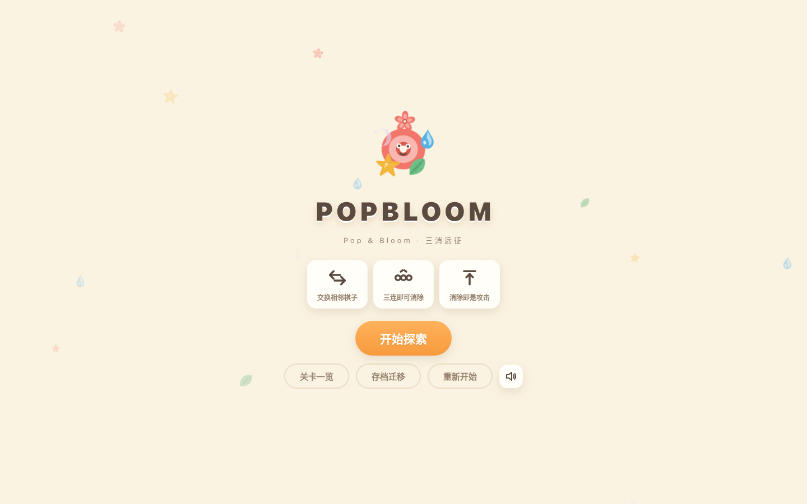
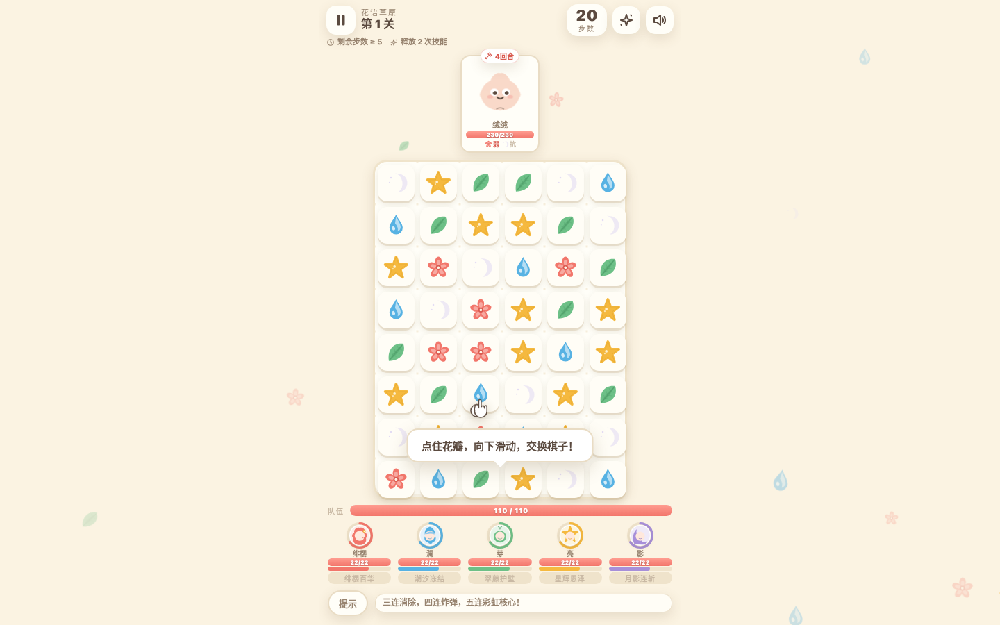
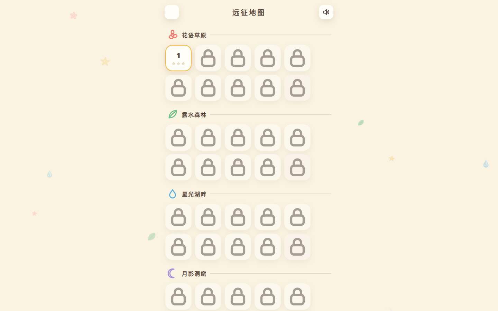
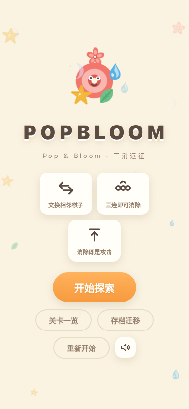

# POPBLOOM · 三消远征

> 消除即是攻击。带上五位英雄，穿过六片花海，把 60 关的怪物一只只打回去。

一款零安装、打开即玩的三消 RPG：6×8 棋盘上交换棋子，三连消除化作伤害；五位英雄各有技能，怪物分波登场，还有祝福、封印与特殊棋子——每一关都得动点脑子。

**立即开始**
- **在线玩**：https://play.gemmae.dev/（Cloudflare Pages，构建产物）
- **备用地址**：https://game1-4cf.pages.dev/
- **GitHub Pages**：https://keavy-561.github.io/game1/（见下方部署说明，有已知限制）



## 玩法一览

一次交换，就是一次出手。棋盘即战场，消除即伤害。

| 维度 | 说明 |
|---|---|
| **核心操作** | 拖动交换相邻棋子，三个以上同色相连即消除 |
| **消除 = 攻击** | 消除的棋子按颜色化作伤害打向怪物；同色连消越多伤害越高 |
| **步数限制** | 每关步数有限，步数用完还没打完怪物即失败 |
| **目标与星级** | 每关有两个隐藏目标（如「剩余步数 ≥ 5」「释放 2 次技能」），达成情况决定 1–3 星结算 |
| **波次** | 怪物分多波登场，击败一波 +3 步，下一波立刻入场 |



## 特色功能

### 6×8 棋盘 · 五色元素克制

棋盘 6 列 × 8 行，共 48 格。五种棋子各有元素属性，怪物也有弱点与抗性：

| 棋子 | 元素 | 颜色 |
|---|---|---|
| 花瓣 | 炎 | `#F2766B` |
| 水滴 | 潮 | `#57B2E3` |
| 叶片 | 风 | `#6DC087` |
| 星星 | 光 | `#F5B93F` |
| 月牙 | 月 | `#A78FD9` |

命中弱点伤害 ×1.6，命中抗性伤害 ×0.75；连续消除还有连锁倍率（最高 ×3.0）。开局先看怪物头顶的弱点色，再决定消哪一片。

### 五位英雄，各有绝活

全队生命 110，由五人平分（每人 22）。消除对应颜色的棋子为该英雄充能，能量满即可释放技能。英雄被打到 0 血会晕厥、无法放技能，治疗可以把人救回来。

| 英雄 | 称号 | 技能 | 效果 |
|---|---|---|---|
| 绯樱 | 花剑士 | 绯樱百华 | 对当前血量最高的敌人造成 7 倍攻击伤害 |
| 澜 | 潮汐法师 | 潮汐冻结 | 全体敌人延后 2 回合，各受 2 倍攻击伤害 |
| 芽 | 翠藤守卫 | 翠藤护壁 | 获得 40 点护盾，抵挡怪物伤害 |
| 亮 | 星辉牧师 | 星辉恩泽 | 立即恢复全队 45 点生命 |
| 影 | 月影游侠 | 月影连斩 | 对所有敌人各造成 2.5 倍攻击伤害 |

战斗开始前会弹出「远征队伍」面板，五位英雄的技能一览一次看清；战斗中点英雄头像可随时查看。

### 60 关 · 6 个章节 · 章节 BOSS

| 章节 | 关卡 | 章节 BOSS |
|---|---|---|
| 花语草原 | 1–10 | 花王·绒球 |
| 露水森林 | 11–20 | 蘑菇长老 |
| 星光湖畔 | 21–30 | 深湖泡影 |
| 月影洞窟 | 31–40 | 洞窟石像 |
| 风暴崖顶 | 41–50 | 云端之王 |
| 终焉花园 | 51–60 | 终焉荆棘王 |

关卡难度确定性生成，同一关每次打开都一样。1–4 关单波、5–9 关两波、10 关起三波；每 5 关的最后一波会出现超级 BOSS（精英怪，金边、大体型、带重击）。



### 特殊棋子与组合

- **炸弹**（4 连）：爆炸清除 3×3 范围，连锁引爆其他特殊棋子，还能直接炸毁石块。
- **彩虹核心**（5 连）：点击后选一种颜色，全场同色一起消除（消耗 1 步）；也可以直接把它拖到相邻棋子上。
- **十字雷**（T / L 型）：清除所在整行与整列。

特殊棋子两两交换还能打出组合：

| 组合 | 效果 |
|---|---|
| 彩虹核心 + 彩虹核心 | 清除全场 42 格 |
| 彩虹核心 + 炸弹 | 指定颜色的每颗棋子各炸一个 3×3 |
| 彩虹核心 + 十字雷 | 指定颜色的每颗棋子各清一行一列 |
| 炸弹 + 炸弹 | 落点 5×5 超级爆炸 |
| 炸弹 + 十字雷 | 整行 + 整列 + 双落点 3×3 |
| 十字雷 + 十字雷 | 双落点各自的整行整列 |

### 祝福三选一

每打赢一关，从三张祝福卡里挑一张带走，全程叠加。共 20 种祝福：全伤害 +10%、单色伤害 +12%、能量获取 +20%、开局护盾、生命上限 +25、每回合回血、步数 +2、击败回血、弱点增伤……阵容越打越像你自己的。

### 封印元素

17 关起，某些颜色会被「封印」：封印色的消除不造成伤害、也不给英雄充能，但照常消耗步数、怪物照常行动。被封印的颜色越多，越要靠剩下的颜色和技能打穿防线。

### 怪物也会出招

怪物不只是木桩，每只都有行动倒计时和技能池：攻击、重击（1.8 倍）、护盾、石化（把棋子变成石块）、召唤小萌芽、强化（攻击 +30%）、治疗同伴。倒计时剩 1 回合时会红光预警，别贪刀。

### 提示与教学

- **提示按钮**：随时点「提示」，棋盘会高亮一步好棋（优先推荐组合与高分消除）。
- **新手引导**：第 1 关带分步气泡教学，手把手教交换、连消与技能；彩虹核心第一次出现时也会弹出玩法说明。
- **底部提示卡**：当前该做什么，提示行会直接告诉你（怪物要攻击、技能就绪时都会变色提醒）。

### 存档跟着设备走

打开即自动恢复上次进度——除非你自己点「重新开始」，否则进度永远都在。换设备、换网址也不怕：标题屏的「存档迁移」可以导出一串 `BT1.` 开头的存档码，到新设备上粘贴导入，进度原样带走。

### 音乐与音效，零外部资源

BGM 是纯 WebAudio 合成的八音盒旋律（五声音阶，每章换调），消除、爆炸、技能都有合成音效；图标与角色全部是内联 SVG 手绘。整个游戏不加载任何外部图片、音频或字体，断网也能玩。

## 手机适配

触摸拖拽交换棋子，棋盘与按钮随屏幕尺寸自适应，窄屏与矮屏都有专门的压缩布局。



## 技术栈

- **构建**：Vite 7（`npm run build` 产出 `dist/`）
- **语言**：原生 JavaScript（ES 模块），无前端框架
- **样式**：手写 CSS，无组件库
- **资源**：零外部依赖——图标、角色、音乐、音效全部代码内生成

## 本地运行

安装依赖后，即可启动开发服务器或构建产物：

```bash
npm install          # 安装依赖（只有 Vite）
npx vite             # 开发服务器，改代码即时热更新
npm run build        # 构建，产物在 dist/
npm run preview      # 本地预览构建产物
```

> `package.json` 里没有 `dev` 脚本，开发服务器直接用 `npx vite` 启动。

构建产物（`dist/`）：

```text
dist/
├── index.html          # 游戏入口
├── index_test.html     # 测试页（存储隔离，不读写真实存档）
└── assets/
    ├── main-*.js       # 游戏逻辑（hash 命名）
    └── style-*.css     # 样式
```

## 部署

### Cloudflare Pages（推荐，当前线上版本）

项目已接 GitHub：推送到 `main` 分支即自动构建部署。

- 构建命令：`npm run build`
- 输出目录：`dist`
- 线上地址：https://play.gemmae.dev/（已验证 200，引用构建产物哈希文件），备用地址 https://game1-4cf.pages.dev/

### GitHub Pages（已知限制）

https://keavy-561.github.io/game1/ 同样可以打开，但它提供的是 `main` 分支根目录的**源码**，不是构建产物；且源码 `index.html` 用绝对路径引用 `/js/main.js`，在 `/game1/` 子路径下该脚本会 404（已实测），游戏无法启动。**当前请走 Cloudflare Pages 的构建产物链接。** 想让 GitHub Pages 也能玩，需要把入口脚本改成相对路径或改走 Actions 构建。

## 目录结构

```text
game1/
├── index.html          # 游戏入口（标题屏 / 地图 / 战斗屏 / 全部覆盖层）
├── index_test.html     # 测试页：与正式页同构，存储隔离垫片，不污染真实存档
├── build-single.html   # 单文件打包工具：浏览器里打开即可把 CSS + JS 全内联成一个 HTML，双击即玩
├── style.css           # 全部样式
├── js/
│   ├── main.js         # 启动入口
│   ├── data.js         # 配置 / 英雄 / 怪物 / 祝福 / 60 关生成 / 存档
│   ├── board.js        # 棋盘：匹配、特殊棋子、组合、提示
│   ├── battle.js       # 战斗：回合、伤害、技能、怪物行动、波次
│   ├── ui.js           # 界面：标题 / 地图 / 战斗渲染 / 动画 / 引导
│   ├── svg.js          # 全部图标与角色 SVG
│   ├── audio.js        # WebAudio BGM 与音效
│   └── util.js         # 随机数、存储、工具函数
├── docs/               # README 配图（本地构建产物实机截图）
└── 工作进度.md          # 开发过程记录（中文）
```

## 玩法小贴士

1. 先看怪物弱点色：消弱点色伤害 ×1.6，是前期最稳的输出。
2. 四连别急着消：炸弹留到怪物扎堆时再引爆，3×3 的收益远高于一次三连。
3. 彩虹核心别乱点：场上某种颜色特别多时再用，一次清十几颗。
4. 技能别攒着：怪物优先打能量最高的英雄，满了就放，放完再攒。
5. 祝福优先拿通用增伤与步数，单色祝福看你最顺手消哪种颜色。
